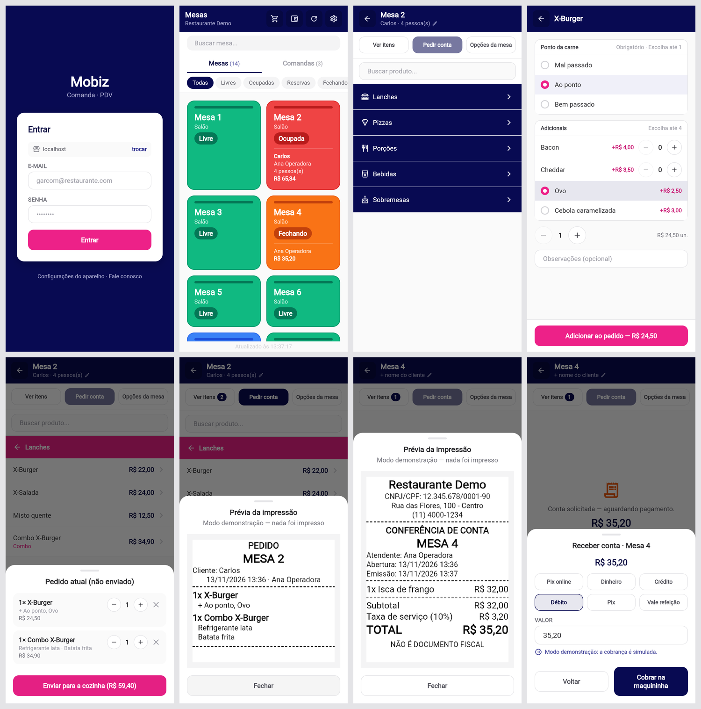

# Mobiz POS (Flutter)

Comanda e PDV do Mobizweb para rodar **dentro da maquininha Stone** (APK
embarcado, POS Android). É a mesma operação do PWA do garçom
(`apps/garcom-pwa` no Mobizweb) — mesas, comandas, balcão e caixa — com duas
coisas que o navegador não faz: **cobrar cartão/Pix na própria maquininha** e
**imprimir conta e pedidos na impressora do terminal**.

O dono continua usando o Mobizweb na web para cadastros, relatórios e
acompanhar as vendas: o app só consome a API `/api/garcom/v1`.



## O que faz

- **Login** com o endereço da loja (subdomínio do tenant), e-mail e senha;
  escolha/troca de loja; permissões do operador vindas do servidor.
- **Menu inferior** com nome em cada aba: Mesas, Balcão, Caixa e Mais.
- **Mesas**: mapa em grade de 4 colunas com a cor do status (livre, ocupada,
  fechando, reservada, ociosa), busca com botão "Entrar" (abre direto a mesa
  ou comanda digitada), chips de filtro com contagem e abas Mesas/Comandas.
- **Notificações** (sino): chamados e pedidos feitos no tablet da mesa e
  estoque crítico, atualizados a cada 30 s.
- **Mais**: notificações, ler QR da comanda (código digitado, sem câmera),
  atualizar, trocar loja, configurações e sair.
- **Mesa aberta**: cardápio em categorias com busca, produto com adicionais
  (mínimo/máximo, repetição), pizza de vários sabores, combo e venda por peso;
  carrinho; envio para a cozinha; itens lançados; cancelar e transferir item;
  conta parcial; couvert; nome do cliente; transferir, reabrir e cancelar mesa.
- **Comandas dentro da mesa**: abrir, renomear, excluir, pedir conta, receber,
  transferir, cancelar, retirar/reaplicar taxa de serviço.
- **Recebimento**: dinheiro (com troco), formas do PDV da loja, Pix online
  (QR do servidor) e **cartão/Pix/voucher cobrados na maquininha**, com
  pagamento parcial e fechamento da mesa.
- **Balcão**: venda rápida com pagamento dividido em várias formas.
- **Caixa**: abertura, suprimento, sangria, detalhes e fechamento (inclusive
  fechamento cego).
- **Impressão na maquininha** (configurável): conta, via do pedido, venda de
  balcão e fechamento de caixa.

## Como está organizado

```
lib/
  core/      api (HTTP + idempotência), formatação pt-BR, tema, canal nativo, armazenamento
  models/    contrato da API (espelho de apps/garcom-pwa/src/types)
  stores/    estado: auth, mesas, cardápio, sessão/comandas, caixa, balcão, pagamentos
  stone/     deeplinks da Stone (URIs + respostas) e o serviço do terminal
  print/     layouts dos documentos e renderização para a bobina
  ui/        kit visual (layout novo do garçom), telas e folhas
android/     MainActivity.kt = ponte dos deeplinks + preferências + token cifrado
tool/        build, deploy, verificação do APK, servidor falso e prévia
docs/stone.md  integração, instalação na maquininha e checklist de homologação
docs/layout-novo.md  layout novo do garçom: componentes, tabela "ação → rotina
               existente" e o que ainda falta trocar
```

Escolhas que valem saber:

- **Deeplink, não SDK da Stone** — dispensa o token do repositório privado e
  mantém o APK pequeno. Detalhes em [docs/stone.md](docs/stone.md).
- **Uma dependência externa** (`http`). Preferências e token passam por um
  canal nativo próprio (token cifrado com chave do Android Keystore), sem
  plugins — menos peso e manifest fácil de auditar.
- **Sem WebSocket**: a Stone proíbe no app embarcado. Mesas e mesa aberta
  atualizam por polling HTTPS (15 s e 30 s), o mesmo fallback do PWA.
- **Dinheiro**: os totais vêm sempre do servidor (`bill`); o app só converte
  reais em centavos para a maquininha, com arredondamento (nunca truncando).
- **Idempotência**: toda mutação leva `Idempotency-Key`; carrinho, venda de
  balcão e pagamento de cartão usam chave fixa por operação, então repetir
  depois de um timeout não duplica.

## Preparar o ambiente

### Windows

Com o [Git](https://git-scm.com/download/win) instalado, no PowerShell:

```powershell
git clone https://github.com/ericallyson/mobizweb-comanda-flutter.git C:\projetos\mobizweb-pos-flutter
cd C:\projetos\mobizweb-pos-flutter
Set-ExecutionPolicy -Scope Process Bypass -Force
.\tool\setup-windows.ps1
```

O script instala o que faltar — JDK 17, Flutter 3.50 e o Android SDK (em
`C:\dev`) —, configura `JAVA_HOME`/`ANDROID_HOME`/`PATH`, baixa as
dependências e roda os testes. Pode ser executado de novo sem problema.
(Se o código ainda estiver só num branch, acrescente `-b <branch>` ao
`git clone`.)

### Linux / macOS

Flutter 3.50 (stable), JDK 17+, Android SDK com `platforms;android-36`,
`build-tools;36.0.0`, `ndk;28.2.13676358` e `platform-tools`. Depois:

```bash
flutter pub get
```

## Compilar e instalar na maquininha

```bash
tool/build.sh          # análise + testes + APK + verificação das regras da Stone
tool/deploy.sh         # instala por USB (adb) e abre o app
tool/deploy.sh --logs  # idem, mostrando os logs
```

No Windows: `.\tool\build.ps1`, `.\tool\deploy.ps1`, `.\tool\deploy.ps1 -Logs`.

**Terminal de debug Gertec ou Positivo** (ex.: GPOS 730): eles só aceitam APK
assinado com a chave do fabricante fornecida pela Stone. Com a `.jks` e o
arquivo de senhas em `C:\projetos\chaves`, um comando configura a assinatura,
compila, instala e abre o app:

```powershell
.\tool\maquininha.ps1
```

O APK sai em `build/app/outputs/flutter-apk/app-release.apk` (~14 MB; limite
da Stone: 70 MB). Sem `android/key.properties` ele é assinado com a chave de
debug — serve para a maquininha de desenvolvimento, não para homologar.
Assinatura, JKS de fabricante (Positivo/Gertec) e checklist:
[docs/stone.md](docs/stone.md).

### Parâmetros do build

Tudo que varia por instalação entra por variável (Linux) ou parâmetro (Windows):

| Variável | Parâmetro `.ps1` | Para quê |
|---|---|---|
| `MOBIZ_STORE` | `-Loja` | Endereço da loja já preenchido no login |
| `MOBIZ_DOMAIN` | `-Dominio` | Domínio central (padrão `mobizweb.com.br`) |
| `MOBIZ_SUPPORT_NAME` | `-SuporteNome` | Nome no "Fale Conosco" |
| `MOBIZ_SUPPORT_PHONE` | `-SuportePhone` | Telefone no "Fale Conosco" |
| `MOBIZ_SUPPORT_EMAIL` | `-SuporteEmail` | E-mail no "Fale Conosco" |
| `MOBIZ_SUPPORT_SITE` | `-SuporteSite` | Site no "Fale Conosco" |

```bash
MOBIZ_SUPPORT_PHONE="(11) 4000-0000" MOBIZ_SUPPORT_EMAIL=suporte@exemplo.com tool/build.sh
```

## Desenvolver sem maquininha

O app roda em qualquer Android (celular ou emulador). Sem os apps da Stone
ele avisa em Configurações e passa a só **registrar** cartão/Pix; ligando o
**Modo demonstração** ele simula a cobrança e mostra na tela o que iria para
a impressora.

Há também um servidor falso da API, para não depender do Mobizweb:

```bash
node tool/mock-server.mjs     # http://localhost:8787 — qualquer e-mail, senha 123456
```

No login, use como endereço da loja `http://10.0.2.2:8787` (emulador) ou
`http://<ip-do-pc>:8787`. Isso só funciona com `flutter run` (debug): o build
de **release** bloqueia HTTP sem TLS, como a Stone exige.

Prévia no navegador (útil para revisar telas):

```bash
flutter create --platforms=web .          # só na primeira vez; não versionar a pasta web/
flutter run -d chrome -t tool/preview_main.dart
```

## Testes

```bash
flutter analyze
flutter test
```

Cobrem: formatação de moeda e centavos; URIs e respostas dos deeplinks da
Stone (com os exemplos da documentação); layouts de impressão; regras de
adicional e preço de pizza; leitura tolerante do JSON; cliente da API
(idempotência, 401, mensagens de erro); **a conciliação de pagamento da
maquininha** (aprovado, recusado, servidor fora do ar, app encerrado no meio
da cobrança); e o fluxo login → mesas na interface.

## O que ainda não tem (em relação ao PWA)

- **Fila offline de lançamentos.** Sem rede o app mostra os últimos dados e
  bloqueia as ações; o envio do pedido pode ser repetido sem duplicar, mas
  não fica guardado para depois.
- **Central de notificações** do tablet na mesa (chamado de garçom). Os
  pedidos do tablet aguardando liberação aparecem e podem ser liberados.
- **Leitura de QR Code** de comanda/cartão e **QR do tablet** na mesa.
- **Desconto e ajuste de taxa da mesa inteira** (a retirada de taxa por
  comanda existe).
- **Tempo real por WebSocket** — proibido pela Stone; usa polling.
